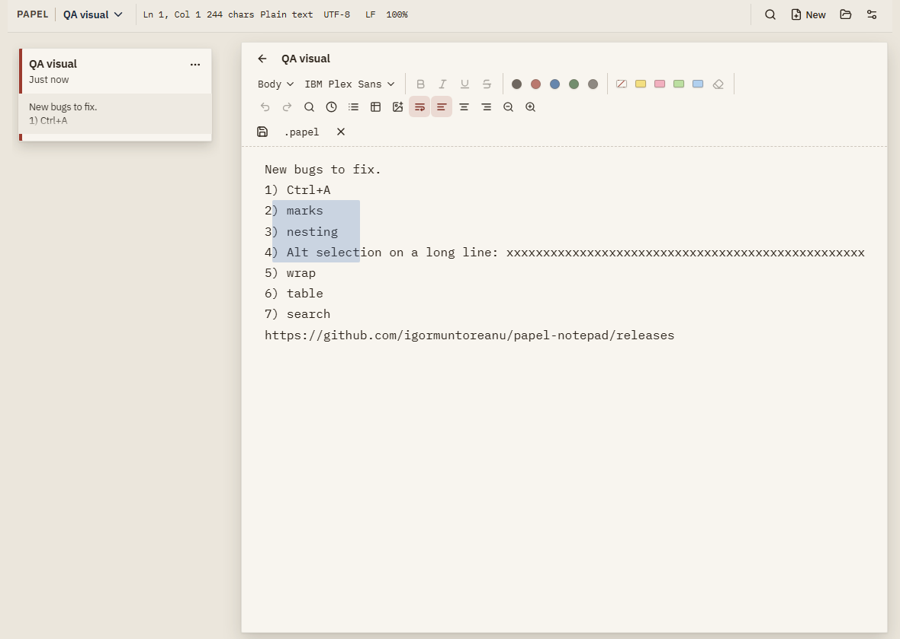
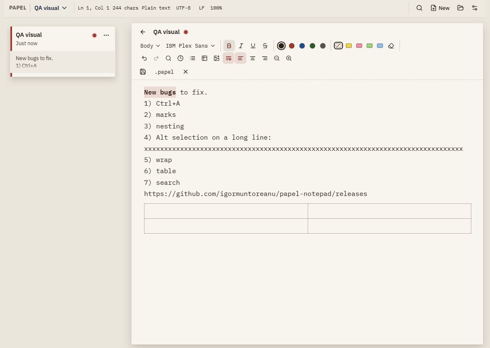
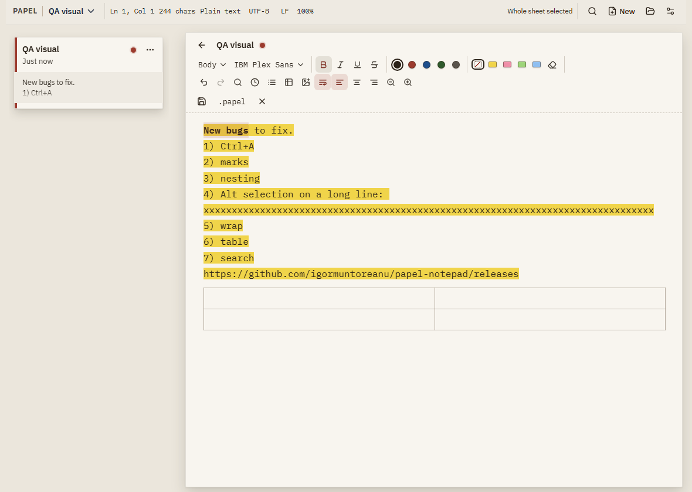
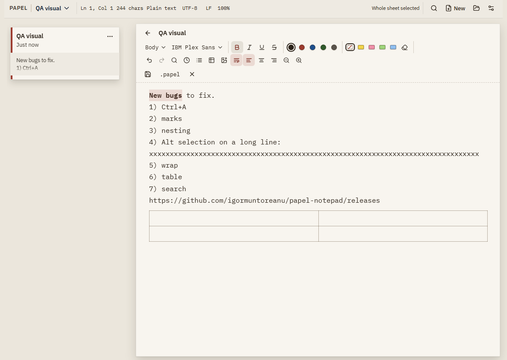
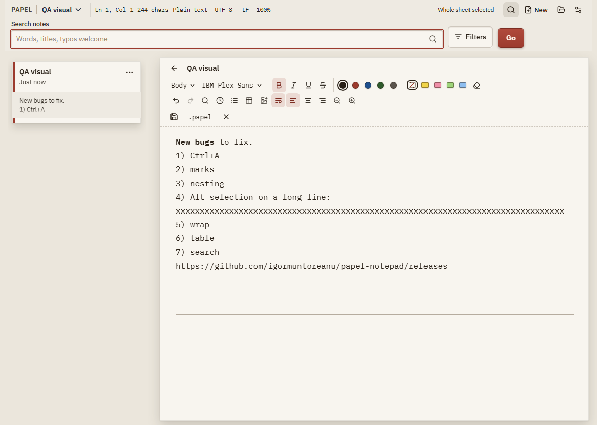

# Visual QA 0.3.3

Captured by `node scripts/qa-visual.mjs` against `dist-desktop/client` (Chromium).
WebView2 portable builds should match these two fixes; add manual shots here if Edge differs.

## Fixes verified

### Alt column select

Blue rect visible; Word Wrap stays on (no sheet-wide horizontal break).

### Toolbar after table

After focusing a table cell, text selection enables Bold and paints emphasis.

## Triage (evidence only)

### Triage: Ctrl+A

Whole-sheet select overlay.

### Triage: wrap / align

Word wrap aria-pressed=true; alignment buttons visible in toolbar.

### Triage: header search (lupe)

Board/header search control opened from the toolbar/filters affordance.

## Triage: list nesting / Enter

Covered by harness case `list-caret-level-3` in `scripts/verify-bugs.mjs` (PASS on 0.3.3). No separate screenshot; caret ends on `1.1.2) X`.

## Harness

Also run `node scripts/verify-bugs.mjs` — includes `alt-drag-column`, `alt-drag-clears-without-wrap-off`, `toolbar-after-table-cell`.
