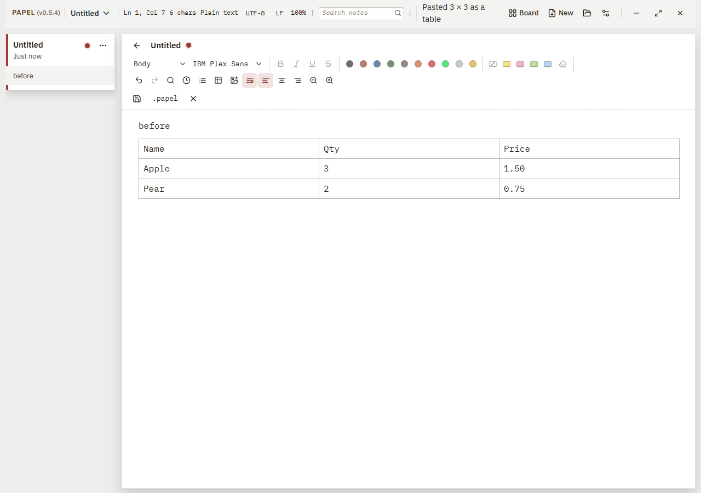
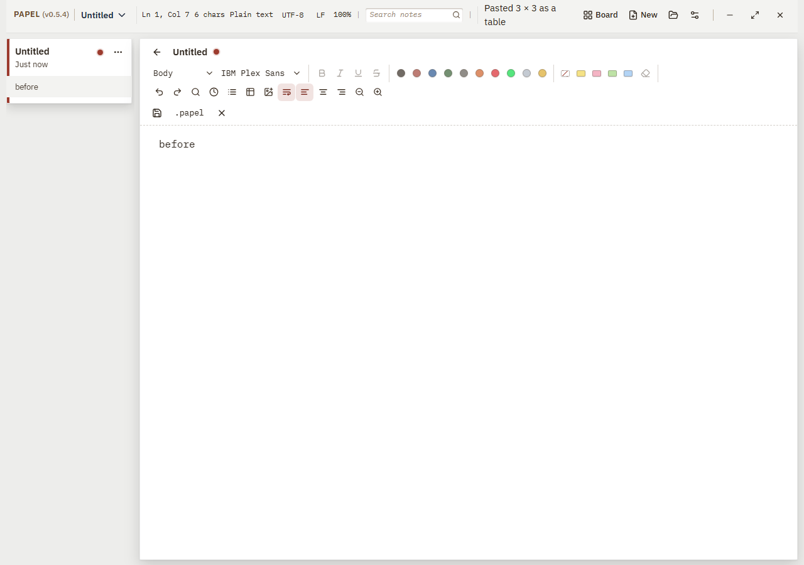
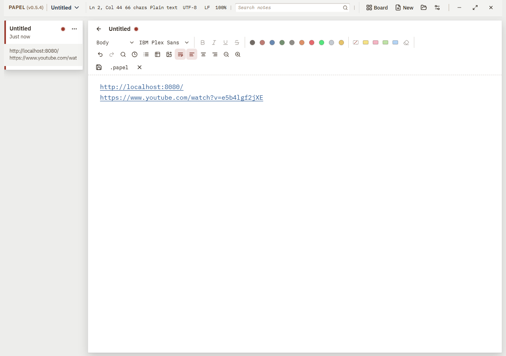
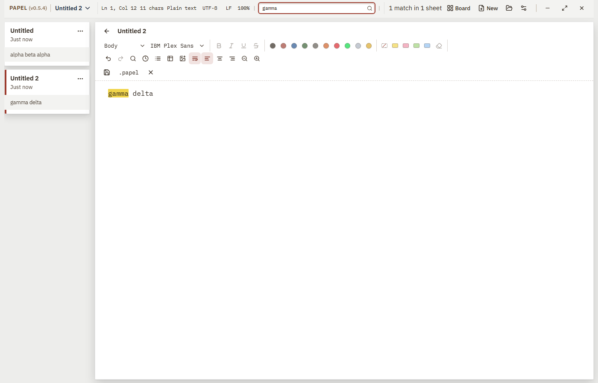

# Visual QA 0.5.4

Captured by `node scripts/qa-undo-paste.mjs` against `dist-desktop/client` (Chromium).
Set `BASE=http://localhost:8080` to run the same guard against the dev server.

## Fixes verified

### A pasted spreadsheet grid is one undo step, and the caret comes back

Paste `Name/Qty/Price` with two data rows (3×3) onto a sheet that already says "before".

Nine non-empty cells, one table block, and the header reports the paste.

A single Ctrl+Z takes the table _and_ the block split with it; the sheet is back to "before"
and the next press undoes that text, as it did before the paste. The status strip in this shot
reads **Ln 1, Col 7** — six characters of text with the caret after the last one, exactly where
the paste started. It read `Col 1` before the caret fix.

### Pasted links are links

Paste a list of URLs, the way a chat client puts them on the clipboard.

Each http(s) URL is Blue ink and underlined — the toolbar's own style runs, not a new
element — and nothing around it is styled. Ctrl+click opens the URL under the pointer;
a plain click just puts the caret down. Both editor renderers share the code path, so the
legacy textarea shows the same thing through its `<pre>` mirror.

Holding Ctrl turns the pointer into a hand over a URL (and shows the URL as a native
tooltip); it stays an I-beam everywhere else, so the pointer never promises a click that
would only place the caret. A screenshot cannot show a cursor or a native tooltip, so that
behaviour is pinned by the guards below (`LK7`–`LK11` assert `data-link-hover`, `title` and
the computed `cursor`).

### Note search lives in the status strip

The search field sits after the zoom level, between two `|`, and stretches to fill every
pixel between them as the window grows (it is the strip's only flexible item). The loupe
doubles as the submit button; the old search band, `Go` and the Filters/Sort button are gone.
Enter (or the loupe) searches every sheet and paints every match yellow. Nothing is written
to the sheet — the yellow is the same `.find-hit` layer Find uses, so clearing the field
simply repaints. Board order moved into Settings, so sorting is not lost with its toolbar
button.

The caret stays in the search field the whole time: searching, backspacing and even a search
that opens another sheet leave focus and the text caret exactly where the user left them.
A repaint of an unfocused block no longer writes a DOM selection into it — that was pulling
focus out of the field.

## Guards

All eight checks pass in `scripts/qa-undo-paste.mjs`:

| Guard                                     | Asserts                                                           |
| ----------------------------------------- | ----------------------------------------------------------------- |
| `UP1-paste-lands`                         | a 3×3 TSV paste becomes one table with nine filled cells          |
| `UP1-paste-clears-in-one-undo`            | one Ctrl+Z removes the table (was ten presses)                    |
| `UP2-redo-restores-grid`                  | Ctrl+Y brings the grid and its cells back                         |
| `UP3-step-before-the-paste-is-next`       | the group is exactly one step — the edit before it is undone next |
| `UP4-clear-sheet-is-one-undo`             | Ctrl+A then Delete (Clear sheet) also reverts in one press        |
| `UP5-undo-restores-caret-after-text`      | caret after the last character stays there (Col 11 of 10 chars)   |
| `UP6-undo-restores-caret-mid-text`        | caret between "hello" and "WORLD" returns to Col 6                |
| `UP7-undo-restores-caret-on-a-later-line` | caret at the end of line 2 returns to line 2, Col 7               |

`scripts/qa-links.mjs` covers the link feature (run it the same two ways):

| Guard                                      | Asserts                                                            |
| ------------------------------------------ | ------------------------------------------------------------------ |
| `LK1-only-the-urls-are-styled`             | exactly the two URLs carry `su ink2`; the ink resolves to `--ink2` |
| `LK2-ctrl-click-opens-the-link`            | Ctrl+click calls `window.open` with the first URL                  |
| `LK2b-ctrl-click-opens-the-second-link`    | and with the second one, so the hit test follows the pointer       |
| `LK3-plain-click-does-nothing`             | a click without Ctrl opens nothing                                 |
| `LK4-ctrl-click-on-prose-does-nothing`     | Ctrl+click on ordinary text opens nothing                          |
| `LK5-one-undo-removes-the-pasted-links`    | the link paste is one undo step, like any other paste              |
| `LK6-legacy-renderer-shows-the-same-links` | the `?ce=0` textarea renderer paints the same two link runs        |

`scripts/qa-search.mjs` covers the strip search:

| Guard                                             | Asserts                                                |
| ------------------------------------------------- | ------------------------------------------------------ |
| `SR1-field-sits-after-the-zoom-with-a-divider`    | order in the strip is zoom → `                         | ` → field; no Go, no Filters |
| `SR2-enter-highlights-every-match`                | Enter paints all matches of the open sheet             |
| `SR3-loupe-button-runs-the-search`                | the loupe submits the same query                       |
| `SR4-opens-the-sheet-that-has-the-match`          | a match elsewhere opens that sheet, painted there      |
| `SR5-clearing-the-field-clears-the-highlight`     | emptying the field removes the yellow                  |
| `SR6-search-writes-nothing-and-adds-no-undo-step` | no style marks written, no undo entry consumed         |
| `SR7-search-from-the-board-opens-the-sheet`       | searching from the board jumps into the matching sheet |

Unit-level guard: `cargo test -p quire-core` → `a_pasted_grid_undoes_in_one_press` (also asserts
the caret undo restores), `a_group_without_edits_records_nothing`, `groups_nest_to_one_step`,
`a_group_survives_an_undo_currently_in_flight`; `npm test` → `urlSpans` (every URL on its
own line, trailing punctuation, prose rejection, no state between calls) and `paint`
(several hits at once, hits layered on style marks).
