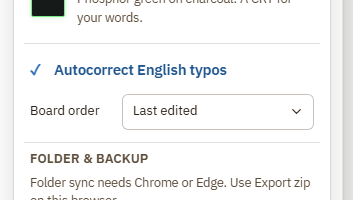

# Board order dropdown

Captured against the dev server (`npm run dev`, http://localhost:8080) in Chromium.

- The **Board order** control is a real dropdown box: 1 px border, rounded corners,
  field background, a `ChevronDown` caret on the right, and a pointer cursor over the
  whole 34 px-high box.
- It offers exactly two options: **Title** and **Last edited** (default). "My order"
  is gone, so the board is always sorted and cards are no longer dragged into a
  hand-kept order (the card menu's Move earlier/later entries are gone too).
- A stored `sort: "manual"` from an earlier build falls back to **Last edited**.

Automated check from the same run: 2 `<option>`s (`title`, `recent`), `recent`
selected, caret present, `cursor: pointer`, `border-top-width: 1px`, no console
errors.

## Regression: the menu no longer dismisses itself while you use the select

`DropMenu` used to close on **any** click inside the popover, so the click that
opened the native option list (or picked a row) also tore down the Settings menu.
The popover's click handler now ignores clicks that land on a `select`, `input`,
`textarea`, `label` or `option`, and still closes for real menu buttons. Guard
from the same Playwright run: opening Settings, clicking the board-order box and
changing the value leaves `.popover` mounted (1 → 1 → 1); clicking a skin card
still closes it (1 → 0).
