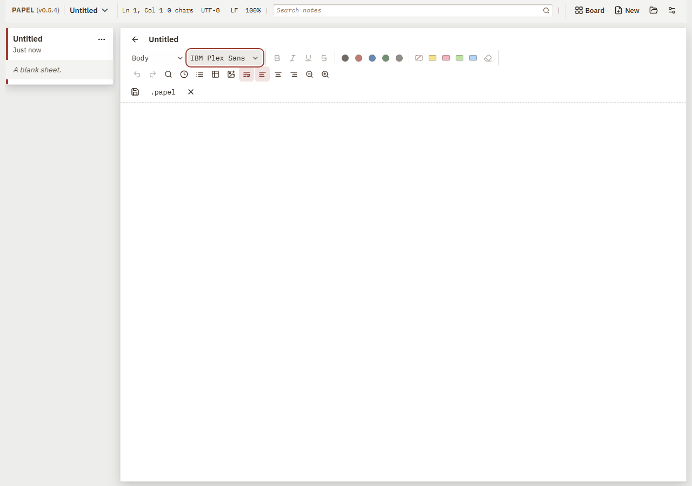
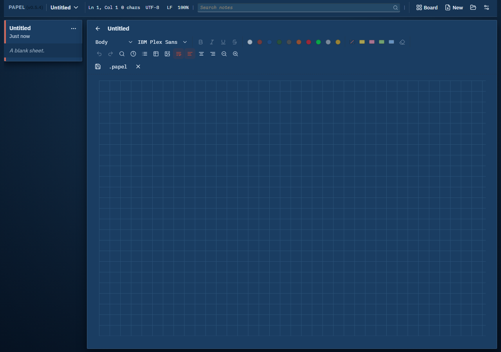

# GrokBot removals — visual QA

Captured against the dev server (`npm run dev`, http://localhost:8080) in Chromium,
after the "remove" list was implemented. Screenshots show the toolbar with an open
sheet; the menu/count assertions were read from the same run.

## What was removed and what the screenshots show

### One editor, plain text

- The legacy `<textarea>` renderer (`src/components/quire/text-block.tsx`),
  `src/lib/quire/ce-renderer.ts`, `?ce=0` and `localStorage["papel-ce"]` are gone.
  The per-line contenteditable renderer is the only editor.
- The "Plain text" badge is gone from the status strip; the strip now reads
  Ln/Col, chars, encoding, EOL, zoom, then the note search.
- The code-language engine is gone from Rust (`detect.rs`, `format.rs`,
  `highlight.rs`, `lang.rs`), from the WASM API, and from TS (`LANGUAGES`,
  `langFromFilename`, `force_language`). Opening `.json`, `.rs`, `.py`, … now
  opens the words as plain text.

### Toolbar: fewer faces, fewer inks on light paper

Sulphite (light paper) offers **5 inks** — Black, Wax red, Blue, Green, Pencil.
The face menu offers **4 faces** — Plex Sans, Inter, Plex Mono, Fira Code
(previously 10). The paragraph-style menu offers **5 styles** — Title,
Subtitle, Heading, Subheading, Body (Section and Subsection were dropped).
The header no longer shows a "Plain text" chip.

Blueprint (and Terminal) offer **all 10 inks**, including the bright ones
(Dark orange, Red, Matrix green, Silver neon, Gold). The bright inks fail
contrast on white/cream paper, so they are not offered there. Documents that
already carry a bright ink still render it.

### Settings

- "Export archive…" is gone; "Export zip…" remains (with "Import backup…" and
  "Last backup: …").
- Board order now lives only in Settings (no toolbar Filters/Sort button).

### Repository

- Removed: `src/lib/auth`, `src/lib/app-data`, `src/lib/multiplayer`,
  `src/lib/db.ts`, `src/lib/env.server.ts`, `migrations/`, the auth/migration
  scripts, and their npm dependencies (`better-auth`, `kysely`, `pg`,
  `@electric-sql/pglite`, Radix, react-query, recharts, zustand, …).
- `npm run build` no longer runs `db:migrate`.
- Font packages for the retired faces and their CSS imports are gone.
- `BUSINESS.md`, `TECHNICAL.md`, `README.md` and the migration note now state
  that every sheet is plain text.

## Guards run for this change

| Check | Result |
| --- | --- |
| `cargo test -p quire-core` | 41 passed, 1 ignored |
| `npm test` | 76 passed |
| `npm run typecheck` | clean |
| `npm run lint` | 0 errors (5 pre-existing warnings) |
| `npm run build` | clean, no migration step |
| Browser smoke (Playwright) | no console/page errors; 5 inks on Sulphite, 10 on Blueprint/Terminal; 4 faces; 5 styles; no "Plain text"/"Export archive"; `?ce=0` no longer switches renderers; bold survives reload |
