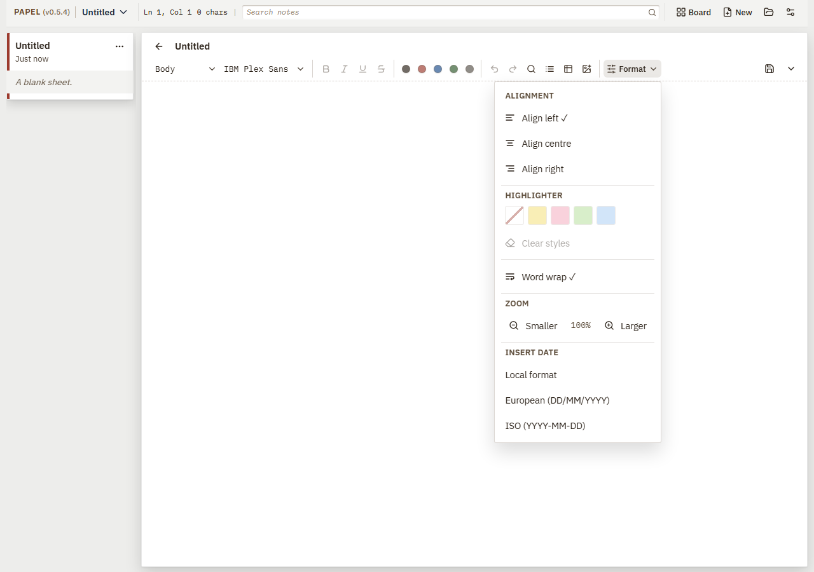
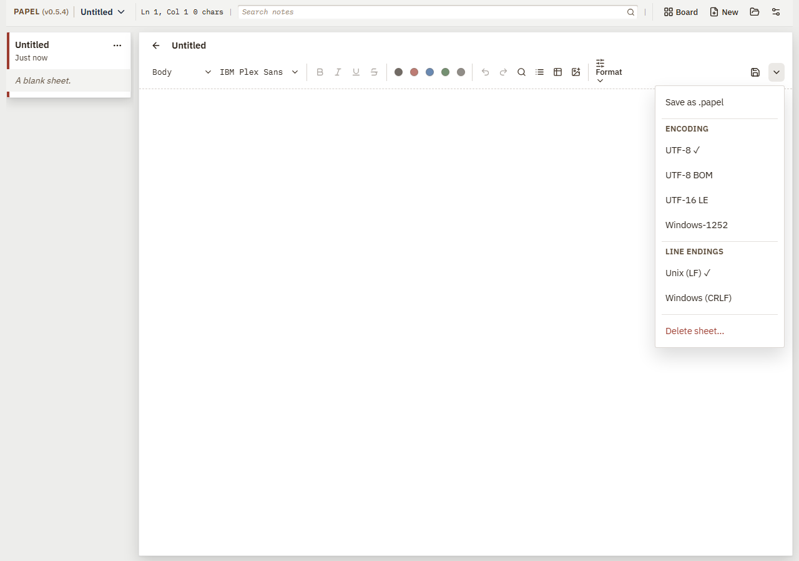
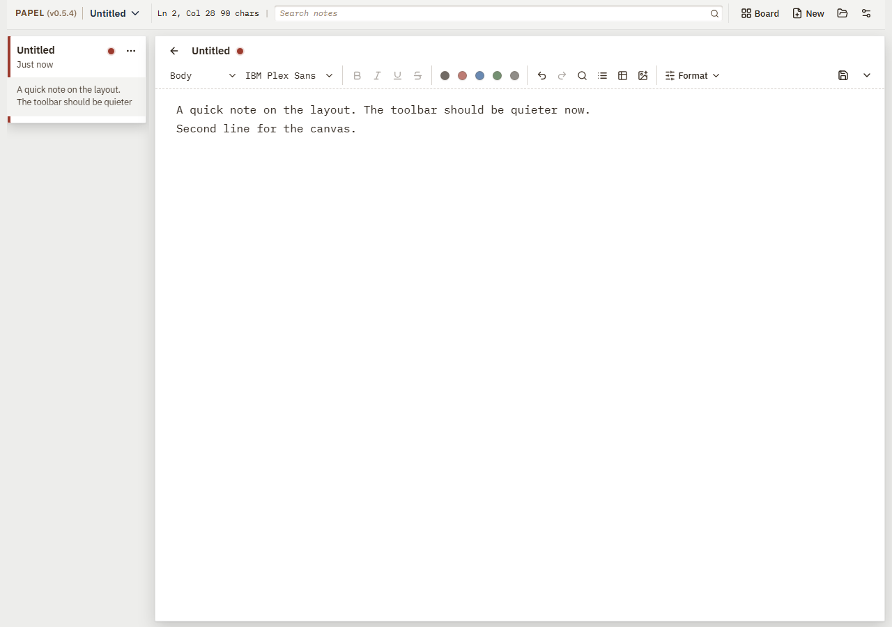
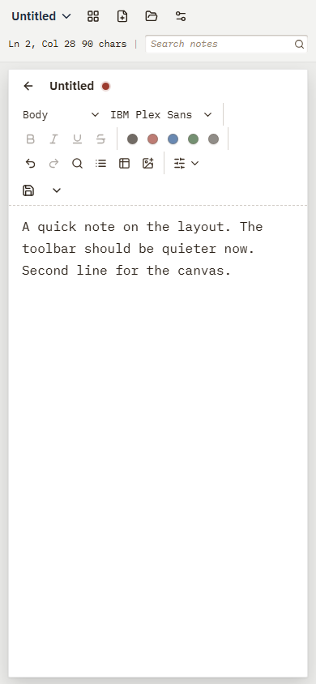
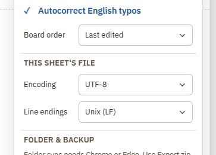

# Layout & icon — visual QA

Captured against the dev server (`npm run dev`, http://localhost:8080) in
Chromium after the toolbar/status-strip rework.

## Sheet toolbar: kept vs moved

The two-row header stays. Row 2 now holds only:

- paragraph style and face
- bold, italic, underline, strikethrough
- the short ink set (5 on light skins, 10 on the dark ones)
- undo, redo, find
- lists, table, insert image (and Delete table while a table has the caret)
- **Format** menu
- **Save** button plus a caret for save options

Moved off the toolbar:

| Control | New home |
| --- | --- |
| Highlighters + Clear styles | Format menu |
| Alignment (3 buttons) | Format menu |
| Word wrap | Format menu |
| Zoom | Format menu (shows the current %, `Smaller` / `Larger`) |
| Insert date (3 formats) | Format menu |
| Extension / save-as | Save options menu |
| Encoding | Save options menu **and** Settings → This sheet's file |
| Line endings | Save options menu **and** Settings → This sheet's file |
| Delete sheet | Save options menu (danger, last item) |

### Format menu

Alignment, highlighter swatches, Clear styles, Word wrap, zoom and the three
date formats in one popover. The zoom row shows `100%` between `Smaller` and
`Larger`.

### Save options

The Save button still saves in one click; the caret opens save-as, encoding,
line endings and Delete sheet. Checkmarks show the sheet's current encoding
(`UTF-8`) and line endings (`Unix (LF)`).

## Desktop

Row 1 is the title; row 2 is style/face, flags, short ink set, edit tools,
Format and the split Save control. The status strip reads brand · sheet
switcher · Ln/Col · chars · search.

## Status strip

The strip keeps the caret position, the character count, the sheet count (and
`N unsaved` only when there is unsaved work) and the note search. Encoding,
line endings and the zoom percentage are gone from the strip. Board mode no
longer prints the folder name or "Autosaved on this device".

## Phone

At 390px the strip wraps: the sheet switcher and the action buttons keep the
first row, and the caret/character counts plus the note search take the second
row at full width. The strip no longer scrolls (scrollWidth == clientWidth) and
the search field keeps about 200px. The Format label collapses to its icon on
narrow screens, so the toolbar wraps less.

## Settings

Encoding and line endings are also in Settings, as boxed dropdowns under
**This sheet's file**, next to Board order. They only show while a sheet is
open, and the popover stays open while the select is used.

## Icon

`public/favicon.svg` is now a bound notepad: cream sheet (`#F3EAD7`), a thick
wax-red spine (`#9C3B2E`) on the left, a folded top-right corner, and a torn
bottom edge. There is no walnut square and no hairline rules, so the mark
matches the default Sulphite skin.

`shells/tauri/src-tauri/icons/make_icon.py` is the only rasteriser. It draws a
full-detail master for 24px and up and a simplified 16px master (cream sheet,
solid spine, plain fold, straight bottom), then writes `icon.png`,
`icon-<n>.png` for 16/24/32/48/64/128/256 and a multi-resolution `icon.ico`.

Checked: the ICO contains all seven sizes and the 16px frame is the simplified
master.

## Guards run

| Check | Result |
| --- | --- |
| `npm run typecheck` | clean |
| `npm run lint` | 0 errors (5 pre-existing warnings) |
| `npm test` | 76 passed |
| Playwright | no console/page errors; toolbar counts (5 inks, 0 highlighters/align/wrap/zoom/date); Format menu items; Save menu items; Settings selects; encoding change reports "Encoding: UTF-8 BOM" |
