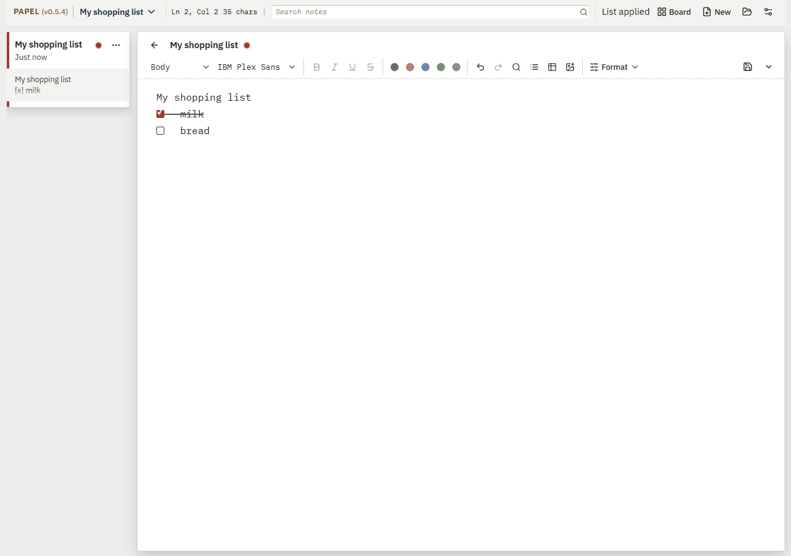
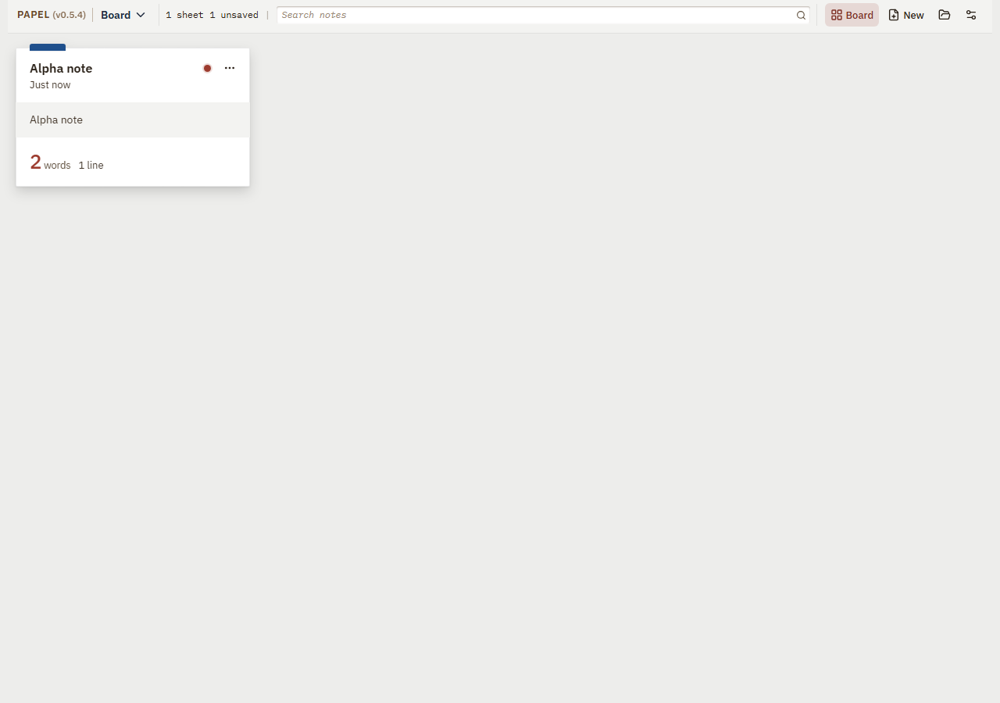
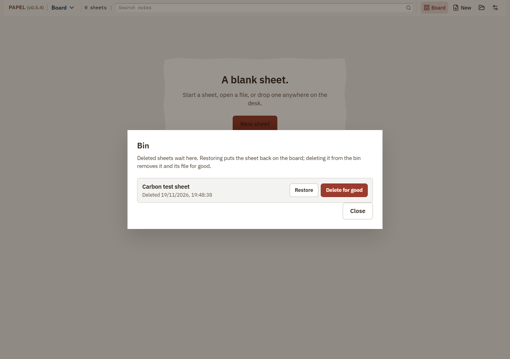
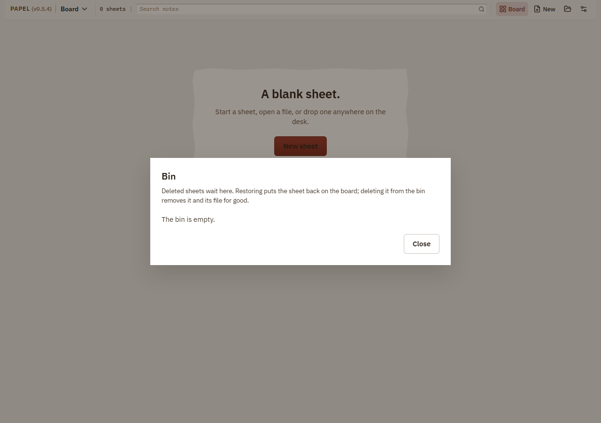
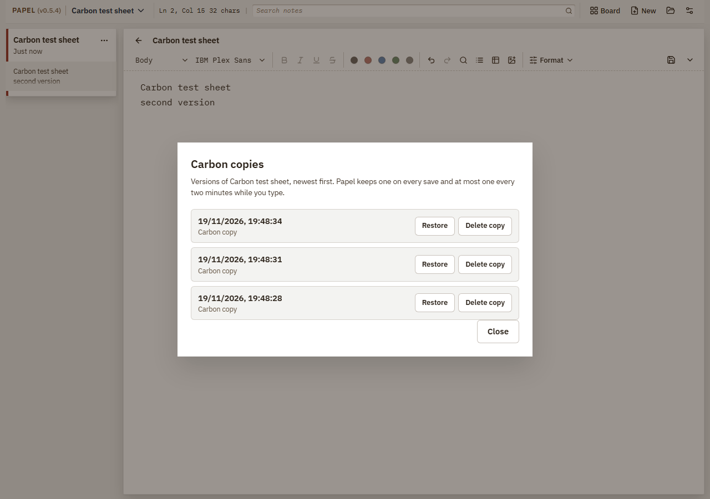
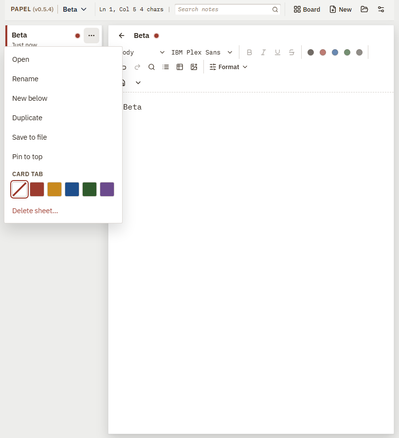

# New features — checklists, titles, tabs/pins, bin, carbon copies

Captured against the dev server (`npm run dev`, http://localhost:8080) in
Chromium. Each screenshot is from the run that also produced the measurements
in the tables below.

## 1. Tickable checklists with a pencil strike-through

- Lists menu → **Checklist [ ]** turns the selected lines into `[ ] ` items.
  Enter continues the checklist with a fresh unchecked item; Tab nests it like
  any other list.
- Clicking a box flips exactly one character (`[ ]` → `[x]`), so a tick is one
  ordinary undo step. Checked lines get a pencil strike-through
  (`--ink4`) and a ticked box.
- It is still plain text: the saved `.txt` / `.papel` contains `[x]`, and the
  card preview shows the checklist as text.

Measured: 2 checklist lines rendered with boxes; clicking one set
`data-check="1"`; computed `text-decoration-line: line-through`; Ctrl+Z set it
back to `0`. Tab produced `  [ ] buy milk`. Unit tests cover parse,
marker, apply/remove, Enter continuation, renumbering and indentation.

## 2. Titles from the first line

In the same screenshot the sheet was created as an "Untitled" sheet, then the
first line `My shopping list` became the sheet title and the card title.

Measured in a separate run:

| Step | Title |
| --- | --- |
| Type `First line title` | `First line title` |
| Rename to `My own name` | `My own name` |
| Edit the line again | `My own name` (manual rename wins) |

Titles collapse whitespace and cap at 60 characters; an empty first line leaves
the numbered fallback alone. `titleFromFirstLine` has unit tests.

## 3. Coloured tabs and pins on cards

- Card `…` menu → **Card tab** row (None + five colours) and **Pin to top**.
- The card shows a coloured strip on its top edge and a pin in the byline.
- Pinned cards sort first while keeping the selected order (Last edited /
  Title) inside each group.
- Both survive a full reload.

Measured: setting Blue then Pin produced 1 `.card-tab` + 1 `.card-pin`; after
reload both were still there and the pinned Alpha card stayed above the newer
Beta card. Tab ids live in `src/lib/quire/tabs.ts` (unit tested).

## 4. Bin with restore

- Deleting a sheet (card menu → **Delete sheet…**, or Save menu → Delete
  sheet…) moves it to the bin. The dialog now says "Move this sheet to the
  bin?" and still requires the acknowledgement tick.
- Settings → **Bin… (N)** lists deleted sheets with *Restore* and *Delete for
  good*.
- Restore puts the sheet back on the board, reusing its file name.
- *Delete for good* asks again and only then removes the folder file.

Measured: after delete, 0 cards and `Bin… (1)`; the bin entry survived a reload;
Restore brought back 1 card and emptied the bin; Delete for good followed by
reopening the bin showed the empty message:

## 5. Carbon copies (per-sheet version history)

- One copy on every explicit Save, plus at most one every two minutes while
  editing (only when the content actually changed).
- Newest first; **Restore** replaces the sheet with that version, **Delete
  copy** removes one entry.
- History is capped at 20 per sheet and identical consecutive versions are
  skipped.

Measured: two saves with different content produced 2 rows; restoring the
oldest row changed the sheet text back to `Version one` and closed the modal.
Unit tests cover append, identical-version skip and the 20-copy cap.

## Regression checks run for the whole branch

| Check | Result |
| --- | --- |
| `cargo test -p quire-core` | 41 passed, 1 ignored |
| `npm test` | 87 passed (added `lists` checklist cases, `titles`, `tabs`, `carbon`) |
| `npm run typecheck` | clean |
| `npm run lint` | 0 errors |
| `npm run build` | clean |
| Playwright: checklist tick / undo / Tab | pass |
| Playwright: title auto → manual rename | pass |
| Playwright: tab + pin + reload | pass |
| Playwright: delete → bin → reload → restore | pass |
| Playwright: delete → bin → delete for good → empty | pass |
| Playwright: save ×2 → carbon list → restore | pass |
| Console / page errors during all runs | none |

## Follow-up fix: card menus no longer clip off the left edge

`DropMenu` right-aligned a popover against its trigger without checking the
popover's own width. A card in the left column (or a narrow window, or a
browser with a vertical sidebar) is narrower than the card menu, so the menu
started at `x = -40` and the left part was unreachable.

`place()` now measures the open popover and clamps `left` between the 8px
viewport margin and `vw - width - 8`, and clamps the vertical edge the same
way. Measured in the focus view's side column: before `left = -40`; after
`left = 8` at 1280/1000/820px wide, and the menu stays fully inside at 600px
(board card). No console errors.

## Notes / limits

- The bin keeps the note in browser storage until purged; if a sync folder is
  linked, the file stays in the folder until *Delete for good*.
- Carbon copies live in the same IndexedDB snapshot as the notes, so the
  autosave cost grows with the number of retained copies (bounded at 20/sheet).
- `titleAuto` is respected: old notes without the flag are treated as manually
  titled, so upgrading never renames them.
