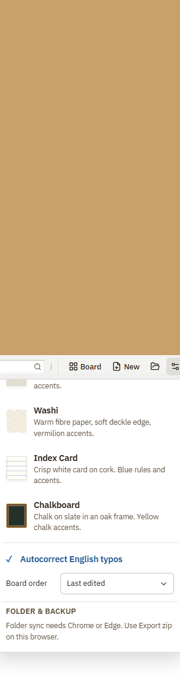
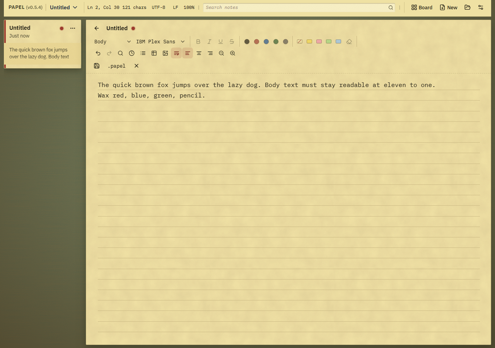
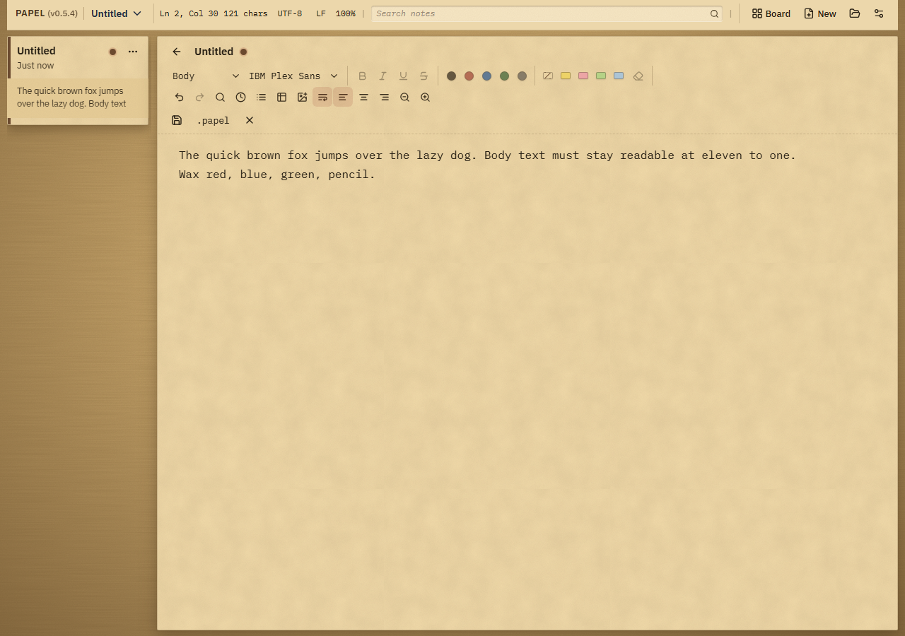
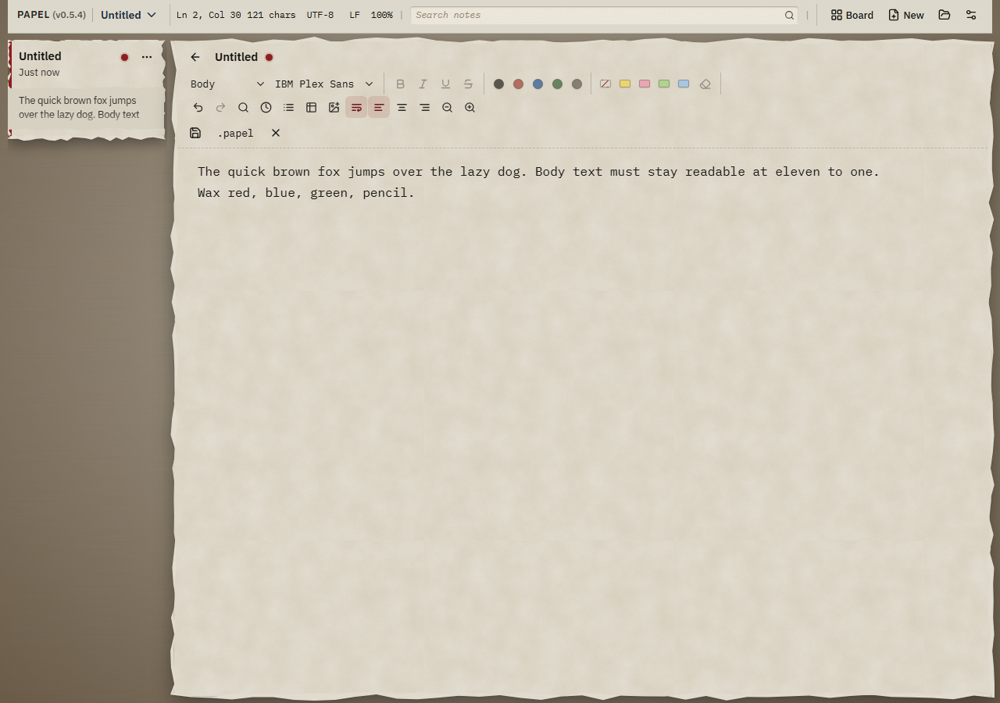
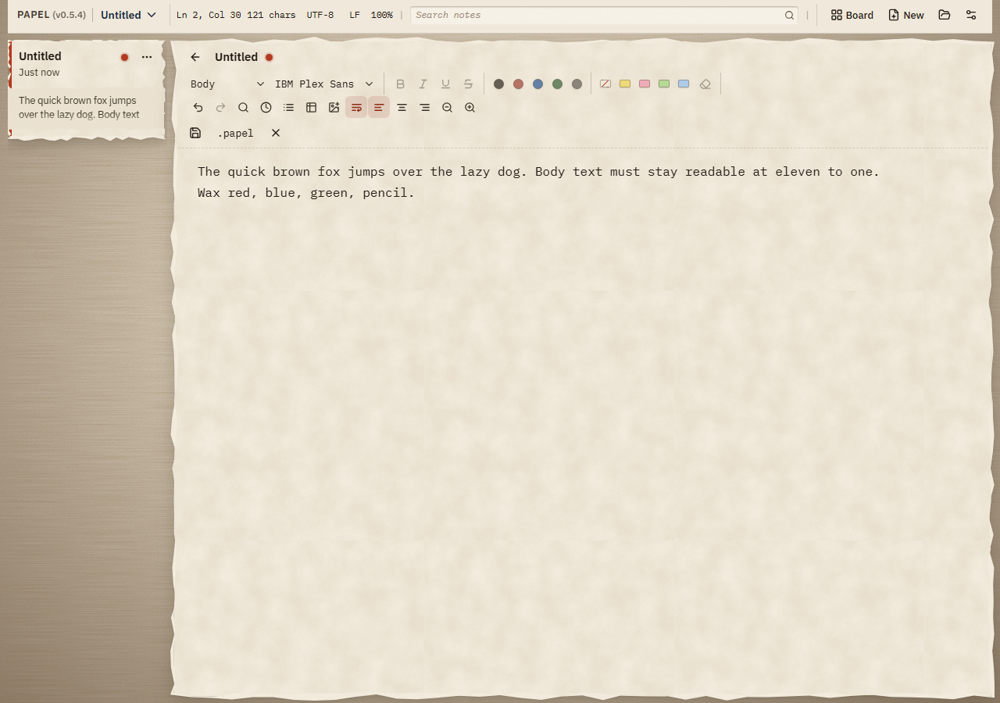
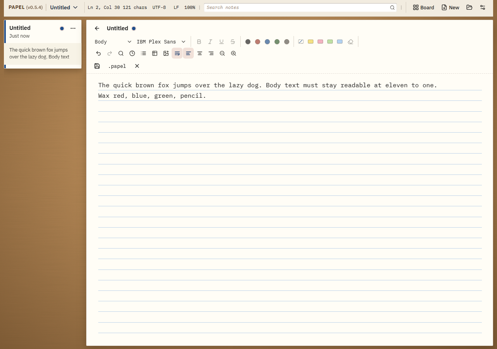
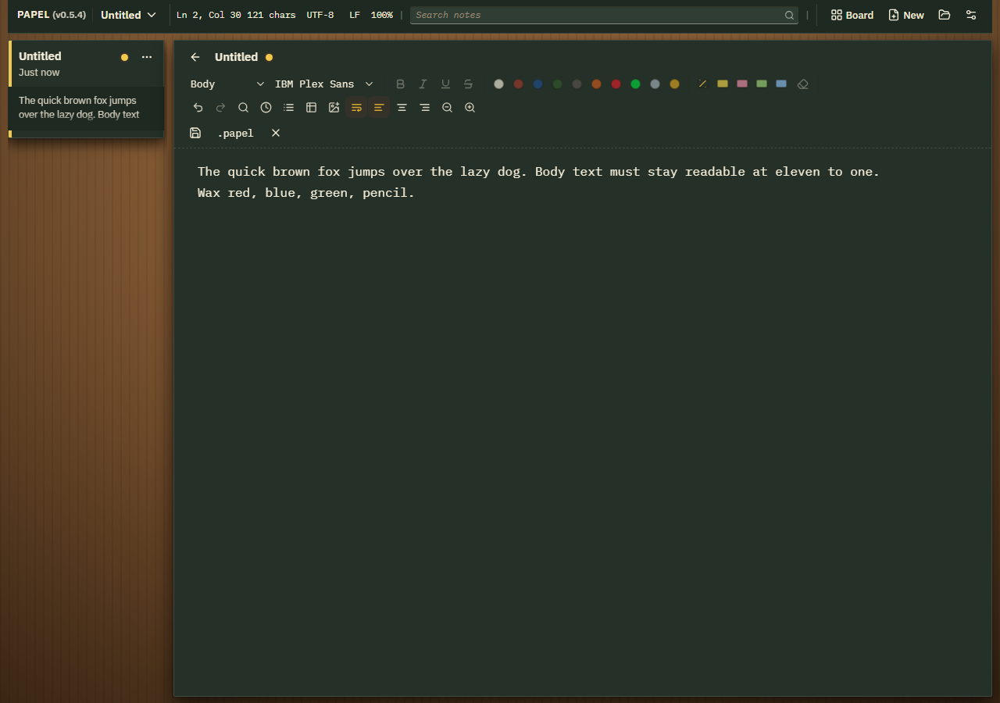

# Paper-shop skins — visual QA

Six new skins, captured against the dev server (`npm run dev`,
http://localhost:8080) in Chromium with one sheet open.

## Contrast

Body text is the editor's `--ink` on the sheet's `--paper`; measured with the
WCAG relative-luminance formula in the same Playwright run that took the
screenshots. Every new skin clears the 11:1 bar.

| Skin | Paper | Ink | Body contrast | Inks offered |
| --- | --- | --- | --- | --- |
| Legal Pad | `#f3e4a6` | `#1f1c12` | **13.35:1** | 5 |
| Manila | `#f0d9a8` | `#241d12` | **12.06:1** | 5 |
| Newsprint | `#e4e0d4` | `#171613` | **13.71:1** | 5 |
| Washi | `#f7f1e4` | `#221c14` | **15.00:1** | 5 |
| Index Card | `#fffdf6` | `#1a1a1a` | **17.10:1** | 5 |
| Chalkboard | `#243028` | `#f4edd8` | **11.75:1** | 10 |

Chalkboard is the dark skin, so it also gets the five bright inks (and the light
`--ink1..9` palette) that Blueprint and Terminal already offer. The five light
skins keep the five paper-safe inks.

## The picker

The six new skins sit after Terminal, each with its own swatch. Selecting one
re-renders the whole desk live and is remembered across reloads (prefs.skin).

## Legal Pad

Yellow ruled paper on an olive blotter, wax-red accent (dirty dot, focus ring,
primary actions).

## Manila

Buff folder paper on a tan desk; saddle-brown accent. No rules — the sheet is a
plain folder.

## Newsprint

Grey newsprint with a torn deckle edge, near-black ink and a deep red accent.

## Washi

Warm fibre paper with the shared `--fibers` texture and a torn edge; vermilion
accent.

## Index Card

Crisp, flat white card with blue rules on a textured cork desk; blue accent. The
card itself disables grain/mottle so it stays crisp; the desk keeps them.

## Chalkboard

The dark option: chalk `#f4edd8` on slate `#243028`, an oak frame with a wood
grain, and a yellow chalk accent.

## Terminal comment colour

Terminal's old `--syn-com` (`#5a7a63` on `#161b1a`, 3.65:1) was deleted with the
code-language engine, so there is no comment colour left to fix. The nearest
remaining secondary text token, `--muted` (`#6aa76a`), measures 6.09:1.
